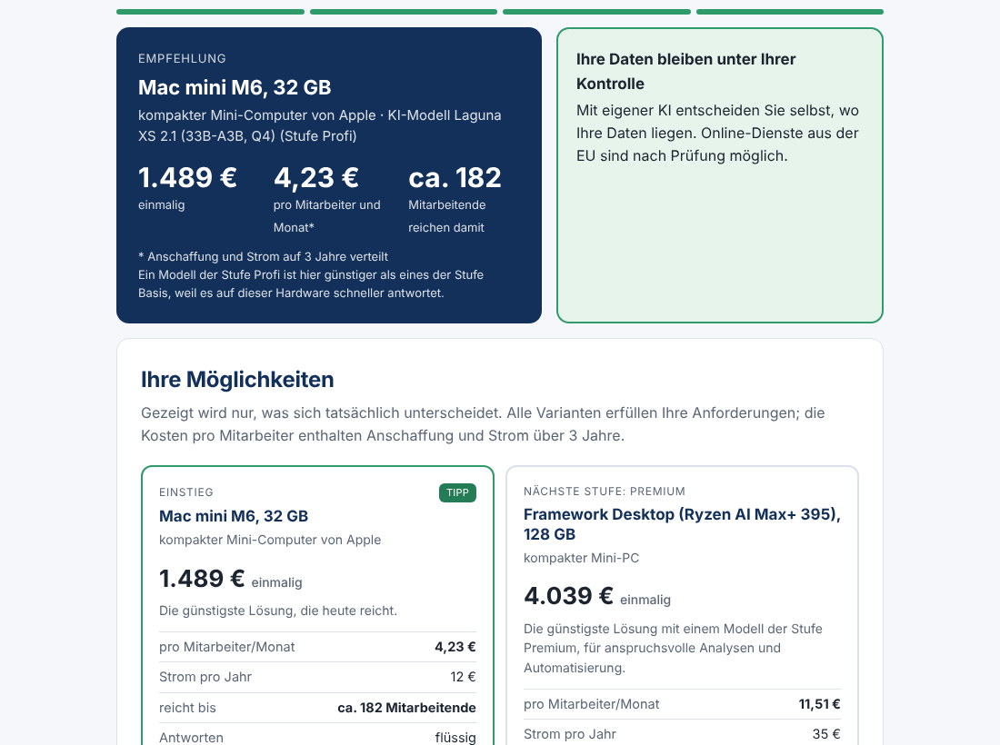
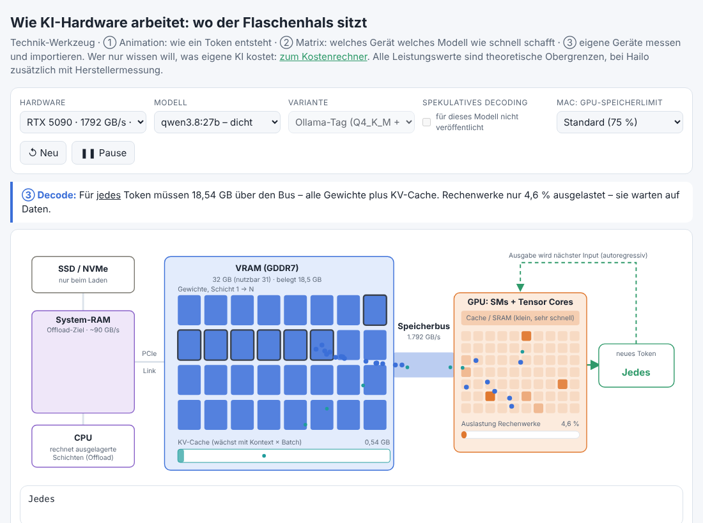

# AI cost calculator

[](https://github.com/NeoGeoOne/ai-cost-calculator/actions/workflows/ci.yml)
[](LICENSE)

Two calculators for running AI on your own hardware, in a single HTML file. It runs entirely in the browser: no server, no sign-in, no tracking. Download, open the file, done. The user interface is German, because prices, VAT and sources refer to the German market.

| View                                        | Address            | For whom                                                                                                      |
| ------------------------------------------- | ------------------ | ------------------------------------------------------------------------------------------------------------- |
| **KI-Kostenrechner** (cost calculator)      | `index.html#aihow` | Decision makers: three questions, then a hardware recommendation, cost per head, cloud comparison, PDF report |
| **Wie KI-Hardware arbeitet** (how it works) | `index.html#toca`  | Technical readers: animation of token generation, device-model matrix, measure and import your own devices    |
| **Datengrundlage** (data view)              | `index.html#daten` | All devices, models, tariffs and assumptions with source and date                                             |

The start page links to the views; the header switches between them.




## Usage

1. On GitHub, use **Code → Download ZIP** and unpack it. Or download only `index.html`; it contains everything.
2. Open `index.html` in a browser.
3. It works offline. Your own prices and advanced assumptions stay in the browser (localStorage); the three answers in the cost calculator are not stored.

You need a current browser (Chrome, Edge, Firefox or Safari from the last two years).

**Advanced assumptions** in the cost calculator (efficiency factor, electricity price, time horizon, your own hardware prices) open via the link in the footer or with `index.html?expert#aihow`.

**Measure your own devices:** in the technical view under "③ Eigene Geräte", download the script `hw-profil.sh` (Linux, read-only) and run it:

```bash
sudo bash hw-profil.sh              # hardware data
sudo bash hw-profil.sh qwen3.8:27b  # also measure the token rate with Ollama
```

Paste the JSON line it prints into the import field. With a measured token rate, the page calibrates the device (theory × measured efficiency).

## How it calculates

- **Token rate** ≈ memory bandwidth ÷ GB read per token. For MoE models only the active experts plus the KV cache count. Values are theoretical upper bounds; 60 to 80% is typical in practice.
- **First answer** (prefill) is compute-bound: 2 × active parameters × prompt tokens ÷ compute.
- **Cost** = purchase + electricity over the time horizon (three years by default), divided by the actual number of employees. "Einstieg" (entry) is the cheapest solution that reaches at least the required performance tier; a model from a higher tier wins if it is cheaper. Every card states up to how many employees it lasts with the same device. Further cards appear only if they differ: "Mit Reserve" (cheapest solution for 1.5× the employees), "Nächste Stufe" (cheapest solution one tier higher, same number of employees), or in the top tier "Ausbau" (2× the employees).
- **Not included:** setup, support, integration with existing software, replacement purchases.

The full assumptions are listed in the cost calculator under "Wie wird gerechnet?" and in the technical view below the matrix.

## Data date and sources

The data view in the file shows every row with source, link and retrieval date. All values were checked against their sources on **2026-10-11**; the log with every checked field, the value found and the verdict is in [docs/data-verification.md](docs/data-verification.md).

Prices and model data as of **2026-10-11**. Hardware prices fluctuate strongly; the figures are guide values, not an offer.

| Data                                    | Sources                                                                                                         |
| --------------------------------------- | --------------------------------------------------------------------------------------------------------------- |
| Technical device data                   | Manufacturer datasheets and whitepapers (Apple, NVIDIA, AMD, Raspberry Pi), measurements where gaps exist       |
| Purchasable systems (price, power draw) | Apple Store, Geizhals, PCGH, 3DCenter, Framework, retailers; power draw from manufacturers or wall measurements |
| Pay-per-use cloud services              | Scaleway (Paris), Mistral – net prices                                                                          |
| GPU rental prices                       | getdeploying (on-demand median) – net prices                                                                    |
| Subscription per seat                   | Mistral Vibe Team ($24.99 net); ChatGPT Business and Claude Team are on par                                     |
| Models (sizes, context, KV cache)       | Publishers' model cards and `config.json`, Ollama library, unsloth GGUF repos, Unsloth docs                     |
| Hailo-10H measurements                  | Hailo Model Zoo GenAI (HailoRT 5.4)                                                                             |
| Exchange rate                           | ECB reference rate of 2026-10-09 (€1 = $1.1206), adjustable                                                     |

Conventions: hardware prices are new prices in Germany incl. VAT; online services, rental and subscriptions are stored net and raised by 19% VAT in the cost calculator. "Last" (load) is the maximum power draw according to the manufacturer or a measurement, not the average while answering. Compute is FP16 dense (without sparsity); where manufacturers give no value (Apple, Hailo, DGX Spark), a marked estimate is used. KV bytes per token assume an FP16 cache and count only layers whose cache grows with context length; for DeepSeek V4 and Mistral Large 4 they are extrapolations (≈).

The Mac Studio M5 Ultra appears twice: as a priced configuration with 256 GB and 96 TFLOPS (cost calculator and technical view) and as the maximum configuration with 512 GB and 120 TFLOPS (technical view only, no price). Mistral Large 4 is included only as an extrapolation until the announced weights are released.

## Updating the data

All tables live in one place in the JavaScript of `index.html`, from the "Data date" section to "Core". Both views calculate with the same values. Data text shown in the page (names, sources) is German.

| Constant                                  | Content                                                                                                                                                                                                                                                                                                                                                      |
| ----------------------------------------- | ------------------------------------------------------------------------------------------------------------------------------------------------------------------------------------------------------------------------------------------------------------------------------------------------------------------------------------------------------------ |
| `STAND`                                   | Data date in the format DD.MM.YYYY, shown in the footer, the method notes and the PDF. From `STALE_MONTHS` (six) full months later, every view and the report state the age of the data                                                                                                                                                                      |
| `DEVICES`                                 | Devices: bandwidth (`bw`, GB/s), memory (`cap`, GB), compute (`tf`, TFLOPS FP16), overhead per token (`ovh`, seconds; multi-GPU servers 0.002 or 0.004), special properties. `spec` names the source of the technical data (`src`, `url`, `date`). For purchasable systems, `sys` holds name, price, power draw under load and at idle, and the price source |
| `MODELS`                                  | Models with parameters (`p`), active parameters (`a`), KV bytes per token (`kv`, `kvEst: true` for extrapolations), context limit (`maxCtx`), all available variants with size, for speculative decoding the measured factor (`spec.x`) and the drafter's memory (`spec.gb`), and the source (`src`, `url`, `date`)                                          |
| `COST_MODELS`                             | Which models and variants the cost calculator uses per performance tier, best first                                                                                                                                                                                                                                                                          |
| `RENT`, `CLOUD`, `SAAS_USD`, `SAAS_SRC`   | Rental prices, cloud tariffs, subscription price per seat, each with a source                                                                                                                                                                                                                                                                                |
| `PEAK`, `AGENT_RPH`, `WORKDAYS`, `VAT`, … | Fixed assumptions of the cost model, named and commented; the data view lists them                                                                                                                                                                                                                                                                           |

Procedure: change the value, record source, link and date in `src`, `url`, `date`, update `STAND`, run `npm test`. Set `STAND` only once every price has been checked: the date controls the outdated-data notice. Price history stays traceable through the Git history; a larger verification round gets an entry in `docs/data-verification.md`.

## Checks

The tests run headless in a browser (Playwright) and cover the walkthrough, persistence, import and the formulas of the calculation core. The same steps run on every push as a GitHub Action.

```bash
npm install          # once, installs Playwright and Prettier
npm run browser      # once, downloads Chromium for Playwright
npm test             # all tests
npm run check        # check formatting (npm run format fixes it)
```

## Contributing

Please report outdated prices, missing devices or calculation errors with the
[data correction form](https://github.com/NeoGeoOne/ai-cost-calculator/issues/new?template=data_correction.yml),
ideally with source and date. Bugs and ideas are welcome as [issues](https://github.com/NeoGeoOne/ai-cost-calculator/issues/new/choose).
Please read [CONTRIBUTING.md](CONTRIBUTING.md) before opening a pull request. Security issues: see [SECURITY.md](SECURITY.md).

## Built with

Plain HTML, CSS and JavaScript in a single file, tested with Playwright. Developed with AI coding agents;
[AGENTS.md](AGENTS.md) holds the rules they follow.

## License

MIT, see [LICENSE](LICENSE). This also applies to the data tables.
